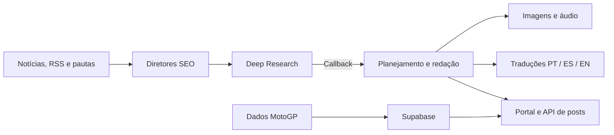

# Moto Na Prática — automação editorial com n8n

Criei o Moto Na Prática pela minha paixão por duas rodas e inteligência artificial. A ideia inicial era colocar uma IA para pesquisar na internet e encontrar informações interessantes sobre motociclismo. Levei mais de 30 dias para construir a primeira versão entregável no n8n, conectada a um frontend.

Com a evolução do projeto, dividi o trabalho em fluxos especializados para escolher pautas, pesquisar, escrever, revisar e preparar mídia para o portal.

## O que construí

- **Pautas e SEO:** consumo de notícias e feeds RSS, consulta a pautas em Google Sheets e consulta a posts já publicados para orientar os agentes.
- **Pesquisa:** integração com o Deep Research, que planeja, coleta fontes, audita e devolve o relatório por callback.
- **Redação:** definição de ângulo, planejamento e escrita por blocos, com saída estruturada e publicação por API.
- **Idiomas:** preparação de artigos em português, espanhol e inglês.
- **Mídia:** integração com Vertex AI, APIs de geração de imagens e Google Text-to-Speech.
- **MotoGP:** coleta de calendário, eventos e resultados, com persistência no Supabase.
- **Revisão editorial:** verificações em JavaScript e avaliação por agente, com retorno estruturado.

## Tecnologias e integrações

n8n, JavaScript, agentes de IA, APIs REST, webhooks, saídas estruturadas, Supabase/PostgreSQL, Google Sheets, n8n Data Tables, feeds RSS, Vertex AI e Text-to-Speech.

O [portal em TypeScript/Next.js](https://github.com/eliejosuevargas01-stack/blog-moto-na-pratica) e a [migração do Deep Research para Python/FastAPI](https://github.com/eliejosuevargas01-stack/Deep-Research) têm repositórios próprios.

## Exports disponíveis neste repositório

Os arquivos abaixo são o snapshot público de 23/09/2026. O diretório `active/` preserva o nome usado no export; a instância continuou evoluindo depois desse snapshot.

| Arquivo | Nós |
| --- | ---: |
| `workflows/active/diretores-seo.json` | 26 |
| `workflows/active/events-scrapper.json` | 13 |
| `workflows/active/deep-research-scrapper.json` | 28 |
| `workflows/active/deep-research-auditor.json` | 25 |
| `workflows/active/deep-research-redator.json` | 13 |
| `workflows/active/escritor.json` | 39 |
| `workflows/active/midia-generator.json` | 22 |
| `workflows/active/tools.json` | 8 |
| **Total do diretório `active/`** | **174** |

O snapshot também contém um planner de 15 nós em `workflows/inactive/` e um backup monolítico de 92 nós em `workflows/backup/`.

Na leitura da API em 15/10/2026, a configuração atual reunia **10 fluxos habilitados e 216 nós** no conjunto Moto + Deep Research: 5 fluxos editoriais/MotoGP com 105 nós e 5 fluxos de pesquisa/recuperação com 111 nós. Essa contagem descreve a configuração consultada; os exports públicos acima continuam no snapshot anterior.

## Documentação

- [Arquitetura](docs/architecture/README.md)
- [Evolução do Deep Research](docs/architecture/deep-research-refactoring.md)

Para adaptar os exports, revise URLs e referências de credenciais e configure suas próprias integrações em uma instância separada.
